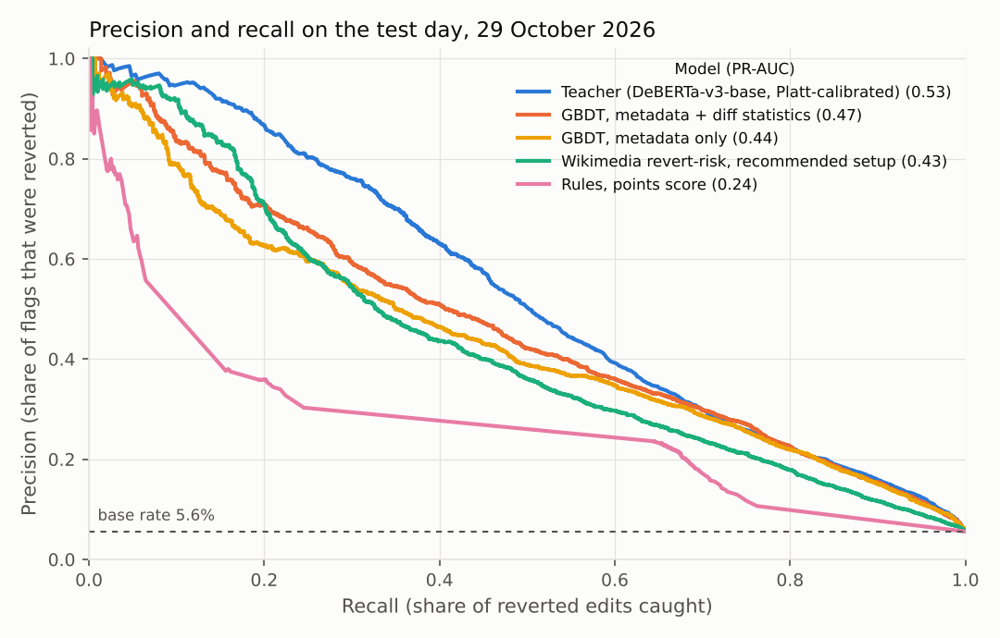
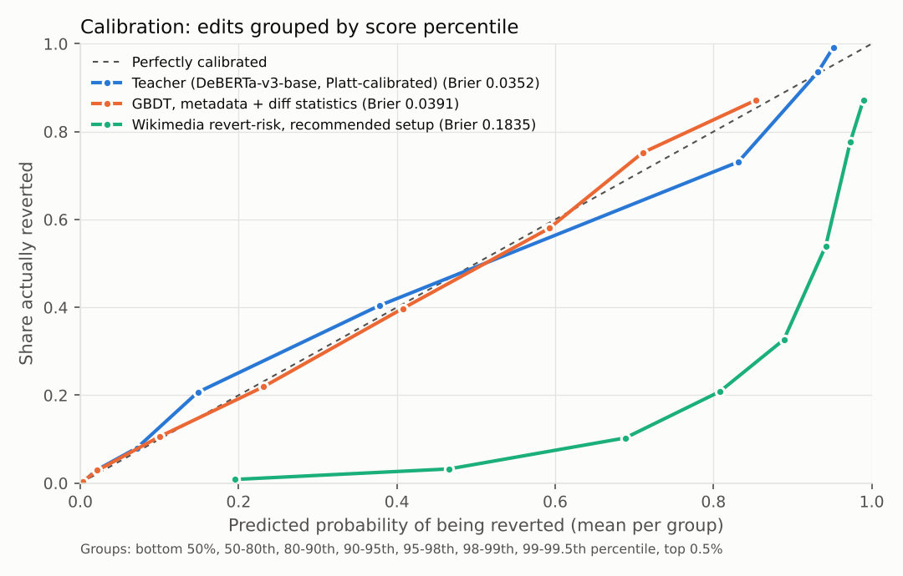

# Phase 2: baselines and the teacher

Which English Wikipedia edits get reverted, and how well can different models
tell in advance? This report compares simple rules, gradient-boosted trees,
Wikimedia's own revert-risk models and a fine-tuned transformer (the teacher
that phase 3 will distil into a small browser model), all on the same test
day.

**Short version.** The teacher (DeBERTa-v3-base reading the diff, the edit
summary and the editor's details as text) is the best of everything tried:
PR-AUC 0.53, and 78% of the edits it ranks in the top 2% were reverted. The best
gradient-boosted tree reaches 0.47 and 67%, and Wikimedia's recommended setup
0.43 and 64%. Most of the teacher's advantage is
on anonymous edits. On edits by experienced registered editors, which make up
a fifth of all reverts, every model is barely better than chance.

## Data

- **Source:** the phase 1 collector, 25 October to 1 November 2026 (952,000
  article edits).
- **Scope:** edits without the bot flag. Bot edits are 30-50% of the stream but
  only 0.17% of them were reverted.
- **Label:** reverted by someone else within 48 hours (MediaWiki's
  `mw-reverted` tag, then the page history to find who reverted and when).
  Self-reverts count as not reverted.
- **Dropped:** edits with no label (706, page or revision deleted since) and
  edits whose diff couldn't be fetched (704, see "Leakage" below), out of
  375,744 edits without the bot flag.

### Split

| Set | Days | Edits | Reverted |
|---|---|---|---|
| Train | 25-27 October | 161,361 | 8,761 (5.4%) |
| Validation | 28 October | 66,029 | 3,525 (5.3%) |
| Test | 29 October, 00:00-16:22 UTC | 51,351 | 2,861 (5.6%) |

No page appears in more than one set: edits on a page that shows up in a later
set are removed from the earlier one, so the test day stays an untouched slice
of live traffic. Busy pages get edited day after day, so this removed 23% of
train edits and 19% of validation edits.

The test set is only part of one day. The collector fell behind on fetching
diffs from 29 October (it fetched one at a time, and each request takes over a
second from Australia), so later days have no diff text yet. That is fixed,
and once the backlog clears these results will be re-run with later weeks as
the test set. Until then, treat a single day as a small sample: the intervals
below are bootstrap intervals over edits, and they don't capture day-to-day
variation.

## Models

**Rules** (no training; each score level is mapped to the revert rate seen at
that level on the validation day):

- anonymous editor and 500+ bytes removed;
- a word from a short profanity list added;
- a points score combining those with blanking most of a page, shouting in
  capitals, and no edit summary from an account with under 10 edits.

**Gradient-boosted trees** (LightGBM, early stopping on the validation day):

- metadata only: editor (anonymous or not, edit count, account age, user
  groups), sizes, edit summary length, change tags, time of day;
- metadata plus cheap statistics of the diff text: characters added and
  removed, share of capitals, links, references, templates, URLs, repeated
  characters, profanity.

**Teacher:** `microsoft/deberta-v3-base` fine-tuned on each edit written out as
text, like this:

```
anonymous editor (temporary account), account under a week, 5 edits
edit: size 72835 to 72855 (+20), 0 lines added, 0 removed, 1 changed
tags: mobile edit, mobile web edit
page: Student List
summary: /* */ link [[Plenary session|plenums]]
removed: (nothing)
added: [[Plenary session| ]]
```

- **Training:** two epochs, batch 32, learning rate 2e-5, bf16, 256 tokens. It
  took 48 minutes on an RTX 3080.
- **Class imbalance:** I trained on the natural 5.4% positive rate with plain
  cross-entropy, starting the output bias at that rate, and chose models by
  PR-AUC. Reweighting the classes would have distorted the probabilities that
  the calibration step then has to fix.
- **Checkpoint:** the best was after the first epoch (validation PR-AUC 0.553
  against 0.548 after the second).
- **Calibration:** two-parameter Platt scaling fitted on the validation day.
  A single temperature left it overconfident across the middle of its range.

**Wikimedia's revert-risk models** on Lift Wing, scored through the public
API:

- **Language-agnostic:** gradient-boosted trees over article-quality features
  of the two revisions plus account age, edit count and number of user groups,
  trained on 2022 edits.
- **Multilingual:** a language model that reads the change. Wikimedia's model
  card recommends it for anonymous edits and the language-agnostic model for
  everything else.

## Results

All models scored on the same 51,336 test edits: the 51,351 above minus 15
that Lift Wing could no longer find. Square brackets are 95% bootstrap
intervals (1,000 resamples).

| Model | PR-AUC | Precision at top 2% | Recall at top 2% | Recall at top 5% | ROC-AUC | Brier |
|---|---|---|---|---|---|---|
| Teacher (DeBERTa-v3-base, Platt-calibrated) | 0.532 [0.514-0.550] | 0.78 [0.75-0.80] | 0.28 | 0.48 | 0.906 | 0.0362 |
| GBDT, metadata + diff statistics | 0.466 [0.446-0.484] | 0.67 [0.64-0.70] | 0.24 | 0.43 | 0.899 | 0.0388 |
| GBDT, metadata only | 0.436 [0.418-0.455] | 0.62 [0.59-0.65] | 0.22 | 0.41 | 0.895 | 0.0400 |
| Wikimedia revert-risk, recommended setup | 0.430 [0.411-0.447] | 0.64 [0.60-0.67] | 0.23 | 0.39 | 0.868 | 0.1872 |
| Wikimedia revert-risk, language-agnostic | 0.297 [0.280-0.314] | 0.37 [0.34-0.40] | 0.13 | 0.31 | 0.860 | 0.2058 |
| Rules, points score | 0.240 [0.226-0.254] | 0.38 [0.36-0.41] | 0.14 | 0.26 | 0.776 | 0.0457 |
| Rule: anonymous + removal of 500+ bytes | 0.096 [0.087-0.106] | 0.18 [0.15-0.20] | 0.06 | 0.09 | 0.503 | 0.0514 |
| Rule: profanity added | 0.074 [0.069-0.081] | 0.18 [0.16-0.21] | 0.07 | 0.11 | 0.509 | 0.0525 |

Base rate: 5.6% of test edits were reverted. Flagging edits at random would give PR-AUC and precision of about 0.056.



**Ranking.**

- **Teacher against the best tree:** the teacher's PR-AUC is 0.066 higher than
  the tree's with metadata and diff statistics (paired bootstrap interval
  0.052 to 0.079).
- **Precision at the top 2%:** at the alert rate the demo will use, 78% of the
  teacher's flags were reverted, against 67% for the tree.
- **Recall:** the flags catch 28% of all reverted edits. Most reverts aren't
  in the top 2% of any model.

**Wikimedia's models.**

- **Recommended setup:** the multilingual model for anonymous edits and the
  language-agnostic one for the rest. It ranks about level with the tree on
  metadata alone (PR-AUC 0.430 against 0.436). The teacher is 0.102 ahead
  (paired interval 0.088 to 0.117).
- **Language-agnostic model alone:** clearly weaker, at 0.297.
- **Anonymous edits** (7,436 of them, 23% reverted):

  | Model | PR-AUC on anonymous edits |
  |---|---|
  | Teacher | 0.651 |
  | Wikimedia multilingual | 0.594 |
  | GBDT, metadata + diff statistics | 0.568 |
  | Wikimedia language-agnostic | 0.371 |

  Wikimedia's multilingual model beats both of my trees here (by 0.026,
  interval 0.004 to 0.048), and the teacher is 0.057 ahead of it (interval
  0.038 to 0.075).
- **Registered editors:** the language-agnostic model is weakest. With 2% of
  edits flagged, it catches 4.5% of the reverts by registered editors in the
  recommended setup, against 12% for the teacher.
- **Fairness of the comparison:** it isn't a level comparison. Wikimedia's
  models were trained on 2022 edits with a different label (any revert), and
  they serve every language, while mine were trained on this exact label from
  the week before. On the other hand, their editor features come from the day
  of scoring, which helps them.



**Calibration.**

- **Teacher:** after Platt scaling, its probabilities track the observed
  revert rate up to about 0.4. Brier score 0.0362, best of all models.
- **Teacher, over-confident spot:** edits it scores around 0.75 (the 98th to
  99th percentile) were reverted 64% of the time.
- **Tree:** slightly under-confident at the top.
- **Wikimedia's models:** their raw outputs aren't calibrated to this revert
  rate. The median unreverted edit gets 0.34 from the language-agnostic model
  (reverted ones get 0.85), which is why its Brier score is poor. That doesn't affect their ranking
  metrics.

## Where the models fall short

| Slice of the test day | Edits | Reverted | Teacher PR-AUC | Tree PR-AUC (with diff statistics) |
|---|---|---|---|---|
| Anonymous (all on temporary accounts) | 7,437 | 23.4% | 0.651 | 0.568 |
| Registered, under 100 edits | 5,056 | 11.6% | 0.523 | 0.449 |
| Registered, 100+ edits | 38,858 | 1.4% | 0.061 | 0.051 |
| Edit cut at 256 tokens | 7,077 | 6.9% | 0.558 | 0.544 |
| Fits in 256 tokens | 44,274 | 5.4% | 0.529 | 0.446 |

- **Experienced editors.** Edits by registered editors with 100+ edits are
  three-quarters of the stream and 19% of the reverts, and no model does much
  better than the base rate on them. Those reverts are mostly content disputes,
  style changes and good-faith mistakes, which the diff alone rarely gives away.
- **Who gets flagged.** 82% of the teacher's top-2% flags are anonymous edits,
  which are 14% of all edits but 61% of reverts. Precision on its flags is
  similar for anonymous (79%) and registered (73%) editors, so it is not
  flagging anonymous edits more readily than their revert rate supports. But
  the demo should still avoid framing a flag as a judgement on the editor.
- **Long edits.** 14% of test edits don't fit in 256 tokens. On those, the
  teacher's lead over the tree almost disappears (0.558 against 0.544). A
  longer input or a smarter cut is the most promising change.
- **Diff text loses context.** For a changed line the input shows only the
  inserted and removed words, so turning a word into a link reads as
  `added: [[ ]]`. Showing a few words either side should help.
- **Labels.** "Reverted" isn't "vandalism". Good-faith edits get reverted too,
  and some bad edits are fixed by hand instead of reverted, so they count as
  not reverted. The model learns what gets reverted, and the demo will say
  "likely to be reverted", not "vandalism".

## Speed

| Model | Time per edit, one at a time |
|---|---|
| Rules | under 0.1 ms |
| Gradient-boosted tree | 1.2-1.3 ms (2-core Xeon, mostly Python overhead) |
| Teacher on the RTX 3080 | 12.6 ms (90th percentile 13.3 ms) |
| Teacher on the desktop CPU | 70 ms (90th percentile 124 ms) |
| Wikimedia, language-agnostic, through the public API from Australia | about 200 ms round trip |
| Wikimedia, multilingual, same | 300-1,000 ms round trip |

Teacher times include tokenisation. The phase 3 budget is under 50 ms per edit
in a browser on a mid-range laptop and under 15 MB to download. The teacher
alone is 738 MB in float32 and 70 ms on a desktop CPU, so distillation is
needed for both.

## Leakage risks and what I did about them

- **Pages in more than one set:** removed, as described in "Split".
- **Same editors in train and test:** 68% of test edits are by editors who
  also appear in training. The models never see a username, only the edit
  count, account age and groups, so they can't memorise individuals. I left
  this as it is, because that's what the live demo will face too.
- **Details fetched after the edit:**
  - **Editor details and change tags:** read about 80 seconds after each edit
    (median), so a fast editor's count includes a few later edits. The live
    demo will query them a few seconds after the edit, which is close enough.
  - **The `mw-reverted` tag:** this is the label, so it is removed from the
    save-time tags.
  - **Tags read 48 hours later:** never used as features.
- **Diffs fetched late:** diffs are fixed once an edit is saved, so fetching
  them days later gives the same text. But if a revision was deleted or
  hidden before its diff was fetched, the fetch fails, and that happens more to
  bad edits: 34% of failed fetches were reverted, against 6.4% overall.
  Keeping those edits without a diff would let a model learn "no diff means bad
  edit", so they are dropped. They were 704 edits, 0.2%.
- **Wikimedia's models had an edge, not a handicap:** Lift Wing computes its
  editor features when it's called, a week after the edits here, so its edit
  counts include later edits. It was also trained on a different label (any
  revert, from 2022). Both caveats apply when comparing.
- **Time of day:** the test set covers 00:00-16:22 UTC only, which
  under-represents North American evenings. Whole later weeks will remove this
  issue.

## Next

- **Re-run on later weeks:** once the collector's diff backlog clears (about
  9 November), re-export 30 October onwards and re-run everything with whole
  later weeks as the test set.
- **Phase 3:** distil the teacher into two student sizes, export to ONNX,
  quantise to int8, and measure them in the browser against the budget.

## Reproducing

```
python -m training.train_teacher --split v1 --exports EXPORTS --out runs/teacher-v1      # GPU
python -m training.baselines     --split v1 --exports EXPORTS --out runs/baselines-v1
python -m training.liftwing      --rev-ids test_rev_ids.parquet --out runs/liftwing-test.jsonl
python -m training.liftwing      --rev-ids test_anon_rev_ids.parquet --out runs/liftwing-ml-anon.jsonl \
                                 --model revertrisk-multilingual --rate 5
python -m training.compare       --split v1 --exports EXPORTS --teacher runs/teacher-v1 --baselines runs/baselines-v1 \
                                 --liftwing runs/liftwing-test.jsonl --liftwing-ml runs/liftwing-ml-anon.jsonl \
                                 --title "Precision and recall on the test day, 29 October 2026" --out reports/phase2
```
