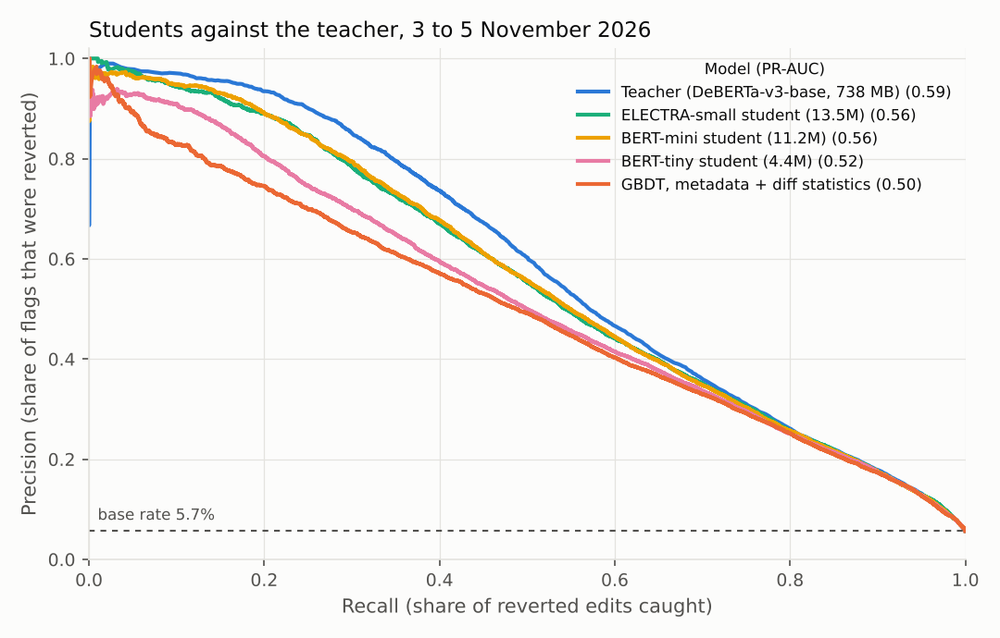
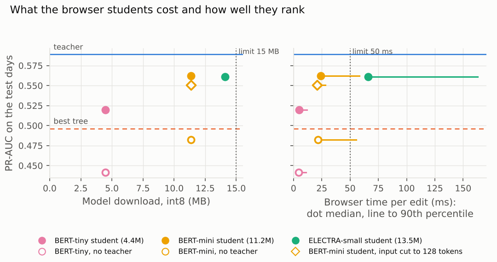
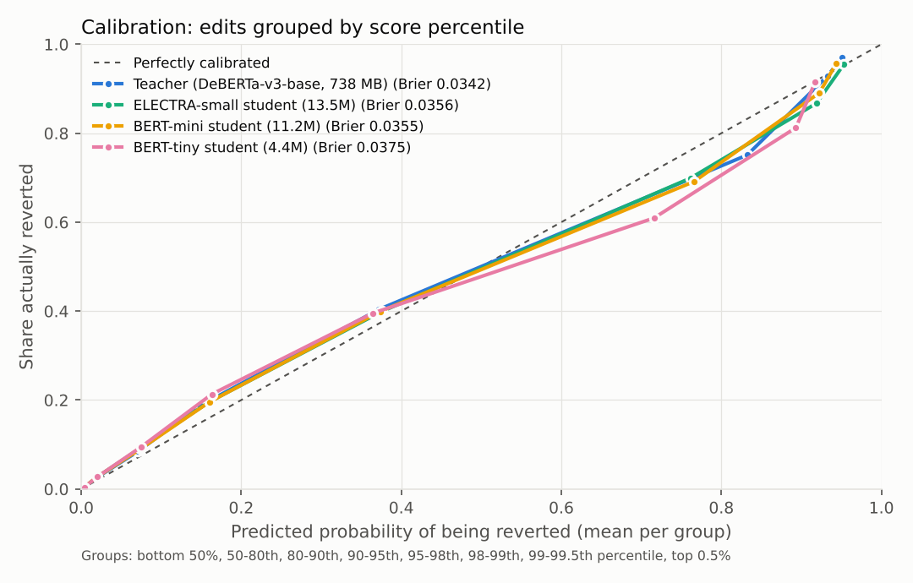

# Phase 3: small models for the browser

Phase 2's teacher (DeBERTa-v3-base, 738 MB) is the best revert predictor I
have, but it is far too big to run in a visitor's browser. This phase
distils it into small students, converts them to int8 ONNX, and measures
them in a real browser against the budget: **under 15 MB to download and
under 50 ms per edit.** Everything is scored on the same three test days as
phase 2, 3 to 5 November 2026 (247,471 edits, 5.7% reverted).

**Short version.**

- **Learning from the teacher matters more than size.** Training on the
  teacher's scores as well as the labels adds 0.08 PR-AUC at both student
  sizes. Without the teacher, neither small model beats phase 2's
  gradient-boosted tree.
- **BERT-mini (11.2M parameters, 11.4 MB at int8)** reaches PR-AUC 0.562,
  0.027 below the teacher and 0.066 above the tree. 81% of the edits it ranks
  in the top 2% were reverted (teacher 85%, tree 70%).
- **BERT-tiny (4.4M, 4.5 MB)** reaches 0.520, 0.023 above the tree.
- **ELECTRA-small (13.5M, 14.1 MB)** is no better than BERT-mini and almost
  three times slower, so it is out.
- **int8 costs nothing measurable.** Each int8 model ranks as well as its
  PyTorch original, and the browser's scores match Python's to within 0.07 on
  the logit scale.
- **Speed in the browser** (one WebAssembly thread on a 2-core server CPU):
  BERT-tiny takes 4.8 ms per edit (median), and 25 ms at the 99th
  percentile. BERT-mini takes 24 ms, but long edits take about 59 ms, over
  the budget. Cutting BERT-mini's input from 256 to 128 tokens brings even
  its slowest 1% of edits under 40 ms, and lowers its PR-AUC from 0.562 to
  0.551. That is still 0.055 above the tree.
- **Where the students fall short** is spelled out in its own section below.
  The main points:
  - BERT-mini loses a fifth of the teacher's correct top-2% flags; BERT-tiny
    loses almost a third.
  - The gap is widest on anonymous edits, where most reverts are.
  - On long edits, BERT-tiny is worse than the tree.
  - Like every model so far, the students rank experienced editors' edits
    poorly (PR-AUC 0.08, against a base rate of 1.3%).

## What I built

### Students

| Student | Layers × width | Parameters | Learning rate | Training time (RTX 3080) |
|---|---|---|---|---|
| BERT-tiny (`google/bert_uncased_L-2_H-128_A-2`) | 2 × 128 | 4.4M | 3e-4 | 5 min |
| BERT-mini (`google/bert_uncased_L-4_H-256_A-4`) | 4 × 256 | 11.2M | 1e-4 | 8 min |
| ELECTRA-small (`google/electra-small-discriminator`) | 12 × 256 | 13.5M | 2e-4 | 18 min |

- **Training data:** the phase 2 training set (408,921 edits, 25 October to
  1 November), three epochs, batches of 64, best epoch by validation PR-AUC
  (2 November).
- **Input:** the teacher's text (editor details, edit sizes, tags, page title,
  edit summary, then the removed and added text), cut at 256 tokens, plus one
  extra line.
  - **The extra line:** all three students lowercase their input, so they
    can't see shouting in capitals. A line such as `capitals: many` says what
    share of the added letters are capitals: too little text (51% of edits),
    few (40%), some (9%), many (0.7%), mostly (0.1%).
  - It goes before the diff text, so cutting a long input never drops it.
- **Loss:** 0.3 × the usual loss on the real label, plus 0.7 × a loss that
  pulls the student's score towards the teacher's.
  - The teacher's score is softened (temperature 2) so the student also learns
    from how sure the teacher was, not only which side it came down on.
  - The teacher's scores on the training edits come from the teacher itself,
    trained on those edits, so they may be more confident than its scores on
    new edits would be.
- **Without the teacher:** BERT-tiny and BERT-mini were also trained on the
  labels alone, with everything else the same, to measure what the teacher
  adds.
- **Scores:** each student is calibrated with Platt scaling fitted on the
  validation day, as the teacher was.

### In the browser

- **Model files:** each student is exported to ONNX and its weights quantised
  to 8-bit integers (dynamic quantisation of the matrix multiplications and
  the embedding table).
- **Runtime:** onnxruntime-web 1.30.0, WebAssembly with SIMD, one thread.
  More threads need the page to be cross-origin isolated, which I haven't
  tested on the site.
- **Tokeniser:** a WordPiece tokeniser in plain JavaScript (`web/wordpiece.mjs`,
  about 130 lines), so the page doesn't need transformers.js.
  - It gives the same token ids as Hugging Face's tokeniser on all 20,017
    texts I checked: real edits plus a few hand-written edge cases, including
    Chinese, Japanese, Cyrillic, Arabic, emoji and unusual Unicode.
  - It takes 0.2 ms per edit.
- **Benchmark:** `web/bench.html` loads a model, scores 500 random test edits
  one at a time (tokenising included, after 10 warm-up edits), and compares
  every score with onnxruntime in Python.
  - Run with `web/bench.py` in headless Chromium 153 on this project's cloud
    machine (2-core Xeon, Linux).
  - This is not the mid-range laptop the budget was set for. The numbers
    would be different there, and I haven't measured one.

## Results

### Quality

Every model was scored on all 247,471 test edits. Student scores are from the
int8 ONNX files, which is what the browser runs. Square brackets are 95%
bootstrap intervals over edits (1,000 resamples).

| Model | int8 size | PR-AUC | Precision at top 2% | Recall at top 2% | Recall at top 5% | ROC-AUC | Brier |
|---|---|---|---|---|---|---|---|
| Teacher (DeBERTa-v3-base) | 738 MB (float32) | 0.589 [0.580-0.597] | 0.85 [0.84-0.86] | 0.30 | 0.51 | 0.917 | 0.0342 |
| BERT-mini student | 11.4 MB | 0.562 [0.554-0.571] | 0.81 [0.80-0.82] | 0.28 | 0.49 | 0.914 | 0.0355 |
| ELECTRA-small student | 14.1 MB | 0.561 [0.552-0.569] | 0.81 [0.79-0.82] | 0.28 | 0.49 | 0.914 | 0.0356 |
| BERT-tiny student | 4.5 MB | 0.520 [0.511-0.528] | 0.74 [0.72-0.75] | 0.26 | 0.47 | 0.910 | 0.0375 |
| GBDT, metadata + diff statistics (phase 2) | | 0.496 [0.487-0.505] | 0.70 [0.69-0.71] | 0.25 | 0.46 | 0.909 | 0.0381 |
| BERT-mini, no teacher | 11.4 MB | 0.483 [0.474-0.491] | 0.69 [0.68-0.71] | 0.24 | 0.44 | 0.897 | 0.0394 |
| GBDT, metadata only (phase 2) | | 0.454 [0.445-0.464] | 0.64 [0.62-0.65] | 0.22 | 0.43 | 0.904 | 0.0396 |
| BERT-tiny, no teacher | 4.5 MB | 0.442 [0.433-0.450] | 0.63 [0.62-0.64] | 0.22 | 0.42 | 0.894 | 0.0404 |
| Rules, points score (phase 2) | | 0.240 [0.233-0.246] | 0.40 [0.39-0.41] | 0.14 | 0.27 | 0.776 | 0.0467 |



**Paired differences in PR-AUC** (95% paired bootstrap intervals):

| Comparison | Difference |
|---|---|
| BERT-mini − teacher | −0.027 (−0.031 to −0.023) |
| BERT-tiny − teacher | −0.069 (−0.075 to −0.064) |
| ELECTRA-small − teacher | −0.028 (−0.032 to −0.024) |
| BERT-mini − tree | +0.066 (0.060 to 0.071) |
| BERT-tiny − tree | +0.023 (0.017 to 0.030) |
| BERT-mini − BERT-mini without teacher | +0.079 (0.074 to 0.084) |
| BERT-tiny − BERT-tiny without teacher | +0.078 (0.072 to 0.083) |

- **The teacher's contribution:** the same small model, trained the same
  way, gains 0.08 PR-AUC from the teacher's scores. That is more than the
  0.04 BERT-mini gains over BERT-tiny from being two and a half times bigger.
- **Without the teacher, the students overfit.** Both were barely better on
  validation after the second epoch than after the first, and got worse in
  the third, so their second-epoch checkpoints are used. The distilled
  students were still improving at the end of the third epoch, so longer
  training might help them. I haven't tested it.
- **ELECTRA-small:** 12 layers instead of 4, and no better than BERT-mini on
  any measure here.

### Day by day

PR-AUC on each test day:

| Model | 3 November | 4 November | 5 November |
|---|---|---|---|
| Teacher | 0.586 | 0.616 | 0.566 |
| BERT-mini | 0.562 | 0.586 | 0.538 |
| BERT-tiny | 0.519 | 0.542 | 0.499 |
| Tree (metadata + diff statistics) | 0.496 | 0.515 | 0.479 |

The order is the same on every day, and the gaps barely move: BERT-mini is
0.024 to 0.030 behind the teacher, and BERT-tiny 0.020 to 0.027 ahead of the
tree.

### Download size

| What | BERT-tiny | BERT-mini | ELECTRA-small |
|---|---|---|---|
| Model, int8 | 4.49 MB | 11.37 MB | 14.11 MB |
| Model, int8, gzipped | 3.26 MB | 8.17 MB | 9.99 MB |
| Model, float32 (for comparison) | 17.6 MB | 44.8 MB | 54.4 MB |

All three models are under the 15 MB limit. The page also needs:

- **onnxruntime-web's WebAssembly file:** 14.24 MB, or 3.66 MB gzipped.
- **Its JavaScript:** 0.07 MB (0.03 MB gzipped).
- **The vocabulary:** 0.23 MB (0.11 MB gzipped), shared by all three.

**First-visit total:**

- **If the host gzips everything:** BERT-tiny 7.1 MB, BERT-mini 12.0 MB.
- **If nothing is compressed:** BERT-tiny 19.0 MB, BERT-mini 25.9 MB.

The runtime is bigger than either model, so the 15 MB limit only holds for
the whole page if the WebAssembly file is compressed. Checked after phase 4
went live: GitHub Pages sends both gzipped (the runtime as 3.72 MB, BERT-mini
as 8.18 MB), so a first visit downloads about 12 MB. Browsers cache all of it
after that.

### Speed in the browser

Headless Chromium on the 2-core cloud machine, one thread, 500 random test
edits scored one at a time, tokenising included. "Full-length edits" are the
71 of the 500 (14%) that fill all 256 tokens.

| Model | Median | 90th percentile | 99th percentile | Full-length edits (median) | Session start |
|---|---|---|---|---|---|
| BERT-tiny | 4.8 ms | 12.0 ms | 25.2 ms | 12.1 ms | 0.50 s |
| BERT-tiny, no teacher | 4.5 ms | 11.1 ms | 20.1 ms | 11.1 ms | 0.55 s |
| BERT-mini | 24.0 ms | 58.4 ms | 85.8 ms | 59.2 ms | 0.61 s |
| BERT-mini, no teacher | 21.8 ms | 55.4 ms | 75.3 ms | 56.6 ms | 0.58 s |
| ELECTRA-small | 66.2 ms | 162.9 ms | 221.2 ms | 164.2 ms | 0.84 s |

- **Repeatability:** the "no teacher" models have the same architecture and
  size as the distilled ones, so their rows show how much the timings move
  between runs: about 10%, and more at the 99th percentile.
- **Time grows with length:** the 500 edits average 138 tokens, and
  full-length edits take two and a half times as long as the median edit.
- **Against the 50 ms budget:**
  - **BERT-tiny** is under it even at the 99th percentile (25 ms).
  - **BERT-mini** is under it on a typical edit but over it on most long
    ones, which are one edit in seven.
  - **ELECTRA-small** is over it on a typical edit.
- **What this means for the demo:** English Wikipedia's stream averages about
  one non-bot edit per second (963,000 in the 12 days collected), so even
  ELECTRA-small would keep up. The budget is about keeping a visitor's laptop
  responsive, not about throughput.



### Cutting BERT-mini's input shorter

Time per edit grows with the number of tokens. So the simplest way to make
BERT-mini fit the budget is to give it less text, without retraining. Only
the edits longer than the cut are affected.

| BERT-mini input | PR-AUC | Median | 90th percentile | 99th percentile | Edits at the cut |
|---|---|---|---|---|---|
| 256 tokens (trained length) | 0.562 | 24.0 ms | 58.4 ms | 85.8 ms | 14% |
| 192 tokens | 0.559 | 22.2 ms | 42.5 ms | 64.5 ms | 21% |
| 128 tokens | 0.551 | 20.9 ms | 28.0 ms | 38.4 ms | 40% |

- **Quality:** PR-AUC is on all test edits. The scores are calibrated on the
  validation day at the same length.
- **Timings and "edits at the cut":** from the same 500 edits as above, in
  separate browser runs, so differences of 10% are within run-to-run noise.

- **At 128 tokens:** BERT-mini is under 50 ms even at the 99th percentile
  (38 ms), and loses 0.011 PR-AUC.
  - Precision at the top 2% falls from 0.81 to 0.79.
  - It is still 0.031 above BERT-tiny and 0.055 above the tree.
  - I didn't compute intervals for these differences.
- **At 192 tokens:** it loses only 0.004, but its slowest edits (99th
  percentile 64.5 ms) are still over the budget.
- **What is lost:** the cut drops the end of the diff on about two edits in
  five. Training at 128 tokens might recover some of the loss. I haven't
  tried it.

### Do int8 and the browser change the scores?

| Model | int8 vs PyTorch, mean logit difference | 99th percentile | PR-AUC, PyTorch | PR-AUC, int8 | Browser vs Python, largest difference (500 edits) |
|---|---|---|---|---|---|
| BERT-tiny | 0.019 | 0.075 | 0.519 | 0.520 | 0.011 |
| BERT-mini | 0.030 | 0.139 | 0.561 | 0.562 | 0.038 |
| ELECTRA-small | 0.063 | 0.229 | 0.560 | 0.561 | 0.071 |

- **Scale:** differences are on the logit scale. A difference of 0.1 moves a
  score of 50% to about 52.5%, and a score of 5% to about 5.5%.
- **int8 vs PyTorch:** measured on all test edits.
- **Float32 ONNX vs PyTorch:** spot-checked on 2,000 edits, and within 0.04
  for every model.
- **Ranking:** int8 makes no measurable difference to PR-AUC. ELECTRA-small
  moves the most, probably because it has three times as many layers for
  rounding errors to build up through.

### Calibration



After Platt scaling, the students are calibrated about as well as the
teacher (expected calibration error 0.007 to 0.009, teacher 0.007).

- **50th to 98th percentile:** all models slightly under-predict. For
  example, BERT-mini gives the 90th-95th percentile group 16% on average, and
  20% of them were reverted.
- **98th-99th percentile:** all models over-predict.
  - Teacher: 83% given, 75% reverted.
  - BERT-mini: 77% given, 69% reverted.
  - BERT-tiny: 72% given, 61% reverted.
- **99th-99.5th percentile:** BERT-tiny also over-predicts, 89% given and 81%
  reverted.

The demo's wording ("likely to be reverted") doesn't depend on the exact
numbers, but a score shown as a percentage would be a few points off in
places.

## Where the small models fall short

The students beat every other model I've tried that would fit in a browser,
but they are not the teacher.

**They miss many of the teacher's correct flags.** Of the 4,214 edits the
teacher ranks in its top 2% that were then reverted:

- BERT-mini leaves 852 (20%) out of its own top 2%.
- BERT-tiny leaves 1,302 (31%).

They make up for part of this with other correct flags. Even so, at the same
alert rate:

- **BERT-mini's flags:** 81% were reverted, against the teacher's 85%. That
  is about four more wrong flags in every hundred.
- **BERT-tiny's flags:** 74% were reverted, eleven more wrong flags in every
  hundred.

**The gap is largest where most reverts are.** PR-AUC by editor:

| Editors | Share of edits | Reverted | Teacher | BERT-mini | BERT-tiny | Tree |
|---|---|---|---|---|---|---|
| Anonymous | 14% | 24.2% | 0.700 | 0.665 | 0.610 | 0.577 |
| Registered, under 100 edits | 10% | 13.1% | 0.617 | 0.593 | 0.550 | 0.533 |
| Registered, 100+ edits | 76% | 1.3% | 0.087 | 0.083 | 0.083 | 0.082 |

- **Anonymous edits:** BERT-tiny is 0.09 behind the teacher here, against
  0.07 overall.
- **Note:** the anonymous figures are on all 35,036 anonymous test edits.
  Phase 2's 0.703 for the teacher was on the anonymous edits in its
  25,000-edit sample.
- **Experienced editors:** every model ranks them poorly (PR-AUC about 0.08
  against a base rate of 1.3%), and the students don't change that. Their
  edits are three-quarters of the stream and 18% of reverts.

**Long edits: BERT-tiny is worse than the tree.** PR-AUC by input length:

| Input length | Share of edits | Reverted | Teacher | BERT-mini | BERT-tiny | Tree |
|---|---|---|---|---|---|---|
| 65-128 tokens | 62% | 6.0% | 0.620 | 0.591 | 0.545 | 0.506 |
| 129-254 tokens | 22% | 4.1% | 0.469 | 0.446 | 0.411 | 0.400 |
| Cut at 256 | 15% | 6.2% | 0.549 | 0.528 | 0.498 | 0.514 |

- **Full-length edits:** BERT-tiny scores 0.016 below the tree.
  - The tree's diff statistics are counted over all of the added and removed
    text.
  - Every transformer here reads only the first 1,400 characters of the diff,
    and on these edits not even all of that fits in 256 tokens.
- **BERT-mini** is only 0.014 ahead of the tree on these edits, against 0.066
  overall.
- **Very short inputs** (up to 64 tokens, 629 edits) are left out of the
  table because there are too few of them to say much.

**What I checked that doesn't explain the gap:**

- **Text the students can't read.** The students' vocabulary turns some
  characters (many non-Latin scripts and symbols) into an "unknown" token.
  - Only 1.4% of test edits have any unknown tokens.
  - On those, the students are about as far behind the teacher as elsewhere
    (these groups are small: 2,915 and 428 edits).
- **The missed flags.** The teacher's correct flags that the students miss
  look like the ones they keep:
  - a similar share of anonymous editors (74% missed against 76% kept, for
    BERT-mini);
  - similar length (median 86 tokens against 87);
  - the same share with unknown tokens (2%).
- **So the gap is spread across ordinary edits.** It isn't concentrated in
  one kind of edit that a rule could patch. It looks like a smaller model
  simply reading the same text less well.

**Other limits:**

- **Speed is measured on one machine,** a 2-core cloud server. I haven't
  measured a laptop or a phone.
- **Speed and accuracy pull against each other for BERT-mini.** Fitting it
  under 50 ms on long edits means cutting its input, which costs 0.011
  PR-AUC.
- **The download is bigger than the model.** The runtime adds 3.7 MB
  compressed (GitHub Pages compresses it), or 14.2 MB where a host doesn't.
- **One training run each.** Every student was trained once, with one seed.
  The intervals above cover the test edits, not training randomness.

## For phase 4

Two students meet both limits on this machine:

| | BERT-mini, input cut to 128 tokens | BERT-tiny |
|---|---|---|
| PR-AUC | 0.551 | 0.520 |
| Precision at top 2% | 0.79 | 0.74 |
| Model download (int8) | 11.4 MB | 4.5 MB |
| First visit, all gzipped | 12.0 MB | 7.1 MB |
| Median / 99th percentile per edit | 20.9 / 38.4 ms | 4.8 / 25.2 ms |

- **BERT-mini at 128 tokens:** the better model. Its slowest edits have the
  least room to spare.
- **BERT-tiny:** has more speed in reserve for slower laptops and phones, and
  is the smaller download.

Before the demo is built, I'd want to time both on a real mid-range laptop
and a phone, using `web/bench.html`.

**Chosen:** BERT-mini with its input cut to 128 tokens. The website flags an
edit when its calibrated score is 50% or more. On the test days that flagged
2.4% of edits; 75% of the flagged edits were reverted, and the flags caught 32%
of all reverts (`training/web_bundle.py`).

## Reproducing

```
# Students (GPU), from training/: run_students.bat, or one at a time:
python -m training.distil --teacher runs/teacher-v2-256 --exports EXPORTS --epochs 3 \
       --model google/bert_uncased_L-4_H-256_A-4 --lr 1e-4 --out runs/student-mini
# Same with --alpha 1 for the "no teacher" runs; BERT-tiny uses lr 3e-4, ELECTRA-small 2e-4.

# int8 ONNX export and scoring
python -m training.export_onnx --run runs/student-mini --splits runs/cache/splits-v2-maxchars1400-student \
       --out web-models/mini

# Browser benchmark (headless Chromium, onnxruntime-web 1.30.0 from npm)
python web/bench.py --model web-models/mini --splits runs/cache/splits-v2-maxchars1400-student \
       --ort node_modules/onnxruntime-web/dist --out reports/phase3/bench-mini.json --n 500

# Tokeniser check against Hugging Face
node web/test-tokeniser.mjs web-models/mini/vocab.txt cases.jsonl

# Comparison, gaps and shorter inputs
python -m training.compare_students --exports EXPORTS --teacher runs/teacher-v2-256 --baselines runs/baselines-v2 \
       --student tiny=web-models/tiny --student tiny_hard=web-models/tiny-hard --student mini=web-models/mini \
       --student mini_hard=web-models/mini-hard --student electra=web-models/electra \
       --bench tiny=reports/phase3/bench-tiny.json ... \
       --cut mini=128=reports/phase3/shorter-inputs-mini.json=reports/phase3/bench-mini-128.json --out reports/phase3
python -m training.student_gaps --splits runs/cache/splits-v2-maxchars1400-student --teacher runs/teacher-v2-256 \
       --baselines runs/baselines-v2 --exports EXPORTS --student tiny=web-models/tiny --student mini=web-models/mini \
       --out reports/phase3/gaps.json
python -m training.shorter_inputs --model web-models/mini --splits runs/cache/splits-v2-maxchars1400-student \
       --lengths 128 192 --out reports/phase3/shorter-inputs-mini.json
```

The browser timings for the shorter inputs use copies of `web-models/mini`
with `max_len` in `tokenizer.json` set to 128 or 192.
